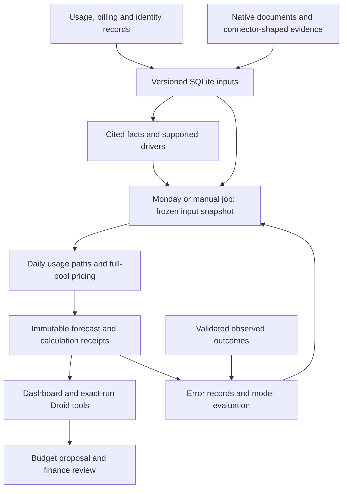

# AI Spend Planner

A finance workspace for understanding company AI spending, forecasting future needs, and reviewing internal budget changes. Built for Cal Hacks 13.0 with Next.js, FastAPI, SQLite, a Python numerical engine, and the Factory Droid SDK.

The dashboard connects company, team, and person spending to the evidence behind upcoming work. Forecast publications preserve the inputs and calculations used at issuance. Droid explains those results and drafts budget proposals; a finance approver controls budget decisions.

## What the workspace does

| Capability | Behavior |
| --- | --- |
| Spending and attribution | Import billing and supported session telemetry, deduplicate records, inspect company/team/person totals, and preserve unattributed or shared amounts. |
| Evidence | Browse documents and cited signals; supported project, staffing, workload, adoption, and pricing facts become numerical drivers. Unsupported facts stay visible as context. |
| Forecasts | Publish immutable forecasts every Monday at 00:00 UTC or on manual refresh. Show seven daily points, four calendar weeks, a cumulative spending fan, and a separate conditional quarter outlook. |
| Explanations and scenarios | Inspect source passages and calculation receipts, ask Droid about an exact issued run, or preview an isolated what-if scenario. |
| Budget planning | Draft additions and transfers, approve or reject proposals, and inspect decision history. New material evidence or budget changes can make a proposal stale. |
| Learning | Refit observed usage rates, score mature observed outcomes, and evaluate a shadow challenger against the serving model and a seasonal-naive reference. |

Budget allocations are internal planning records. They do not purchase compute, move vendor credits, or change provider limits. Droid has read, evidence-recording, proposal-drafting, and forecast tools; it has no budget approval tool.

## Run the integrated demo

Use **Python 3.12** and **Node.js 22.13 or newer**. This Node version supports both the app and its TypeScript test harnesses. Dependency installation and the normal font-loading build need network access.

From the repository root:

```sh
python3.12 -m venv .venv
.venv/bin/python -m pip install -e '.[models,test]' -e './backend[dev]'
PYTHONPATH=src:backend:agent .venv/bin/python -m app.forecasting.demo \
  --output-dir artifacts/northstar-integration --serve
```

Use a **fresh output directory**. This command runs the Northstar acceptance journey, saves its SQLite database and receipts, then serves the backend at `http://127.0.0.1:8787`. The served clock is frozen at November 2, 2026 so the fixture remains reproducible. Its observed history, people, messages, prices, and outcomes are synthetic; Droid uses the deterministic runner and needs no API key.

In another terminal:

```sh
cd frontend
npm ci
NEXT_PUBLIC_API_URL=http://localhost:8787/compat npm run dev
```

Open the dashboard at [localhost:3000/overview](http://localhost:3000/overview). The root `/` route is the product landing page. Keep `/compat` in the API URL: it supplies the frontend's contract shapes.

Omit `--serve` to run the complete acceptance journey without a listening socket. The generated `report.json` records 13 checks alongside source history, connector-shaped events, immutable forecasts, explanations, a Droid answer, an isolated scenario, independent observed truth, and error receipts. See the [runbook](docs/implementation/forecast-integration-runbook.md) and [browser journey](docs/implementation/forecast-browser-journey.md) for a walkthrough.

## Choose a data mode

| Mode | How to use it | What to expect |
| --- | --- | --- |
| Connected Northstar forecast demo | Run the quickstart above | Complete synthetic usage/exposure/pricing fixtures, real API/SQLite/worker execution, deterministic Droid, and a frozen clock. |
| Frontend-only preview | Run the frontend without `NEXT_PUBLIC_API_URL` | In-memory mock data and interactions; changes are not persisted to the backend. |
| Repository records | Seed or import into the normal backend, then run `app.main` | Persistent spending, documents, proposals and decisions. Missing coverage can leave totals unavailable; missing exposure prevents unsupported workload adjustments. |
| Larger generated company | Follow [datagen/README.md](datagen/README.md) | A separate fictional 16-team, 130-person dataset, import files, evidence, and live usage generator. Keep its future holdout out of model inputs. |

To start the normal repository-backed application with the root environment:

```sh
PYTHONPATH=src:backend:agent .venv/bin/python -m app.seed
PYTHONPATH=src:backend:agent .venv/bin/python -m app.main
```

The seed is a no-op if the database is already seeded. On a fresh database it loads example records and interprets its corpus with the deterministic runner. It does not establish the complete daily usage and exposure history provided by the dedicated forecast demo. To use a separate database, set `BACKEND_DB_PATH` consistently for both commands and preserve existing evidence and decisions.

### Configuration

| Variable | Default | Purpose |
| --- | --- | --- |
| `NEXT_PUBLIC_API_URL` | Unset | Set to `http://localhost:8787/compat` to connect the frontend to FastAPI. |
| `BACKEND_DB_PATH` | `backend/data/app.db` | SQLite database for the normal backend. |
| `BACKEND_PORT` | `8787` | Listening port for `python -m app.main`. |
| `FORECAST_PROVIDER` | `engine` | Numerical engine; `placeholder` and `unavailable` are explicit alternatives. |
| `FORECAST_DEMO` | Off | Opt into synthetic forecast inputs in the normal backend. |
| `FORECAST_WORKER` | On | Set `0` for controlled tests without automatic scheduling/processing. |
| `DROID_RUNNER` | `fake` | Deterministic runner; `sdk` enables the Factory integration when configured. |
| `NEXT_PUBLIC_LIVE_REFRESH_MS` | Unset | Configure periodic dashboard reloads for a streaming-data demo, for example `5000`. |

Live Droid requires the backend SDK extra, a `droid` executable, and `FACTORY_API_KEY` supplied through the backend environment:

```sh
.venv/bin/python -m pip install -e './backend[sdk]'
PYTHONPATH=src:backend:agent DROID_RUNNER=sdk DROID_TIMEOUT_S=300 \
  .venv/bin/python -m app.main
```

Use normal `app.main` for this mode. The dedicated forecasting demo constructs its own settings and remains deterministic even if `DROID_RUNNER=sdk` is set. See [agent/README.md](agent/README.md) for CLI setup, model options, tool restrictions, and the scope of earlier live verification. Missing SDK requirements produce an explicit unavailable result.

## Architecture

The backend calls the numerical package directly; no separate forecasting network service is required.



Incoming evidence queues between publications. Current actuals have their own revision and timestamp; they do not rewrite an issued forecast. SQLite jobs persist leases, retries and publication ordering. The source archive retains immutable changed row versions, while older full captures remain readable. Material evidence invalidates dependent proposals immediately, and approval rechecks their dependencies.

### Forecast meaning

- Supported schedule, membership, workload, adoption and pricing changes alter identified workloads from their effective dates. A model release or benchmark improvement alone does not imply adoption or lower token use.
- Rates use exposure-weighted weekday observations over the trailing 56 complete days, with compatible fallbacks. Missing exposure cannot support an invented person/workload decomposition.
- Company, team, person and shared totals are aggregated inside the same daily scenario paths. Supported commercial terms price the complete billing pool before monetary summaries.
- The **scenario range** describes evaluated low/base/high configurations. **Historical-error intervals** are separate and require enough compatible mature errors. Missing data is not zero, and neither band guarantees an entire trajectory.
- The **quarter outlook** is conditional continuation through quarter-end. It is distinct from four planning weeks and stays incomplete when charges or commercial terms are unknown. Billing days remain UTC.
- Each refresh refits observed rates. Automatic model replacement requires genuine reconstructible data, a frozen procedure, 20 calibration weeks and 12 prospective comparison weeks under the [learning policy](docs/learning/README.md). Synthetic fixtures cannot authorize promotion.

### Main integration endpoints

| Interface | Purpose |
| --- | --- |
| `GET /api/forecast-views` | Published or immutable run views by scope, with separate current actuals. |
| `POST /api/forecast-refreshes` | Manual job; requires an `Idempotency-Key` header. |
| `GET /api/forecast-refreshes/{id}` | Durable job progress or failure. |
| `GET /api/forecast-runs/{id}/explanation` | Stored sources, parameters and calculation receipts. |
| `POST /api/forecast-runs/{id}/scenarios` | Isolated what-if job; `GET /api/forecast-scenarios/{id}` retrieves its receipt. |
| `GET/POST /api/forecast-evidence` | Evidence ingestion and included, queued or context-only states. |
| `POST /api/forecast-outcomes` | Validated independent observed outcomes for exact issued targets; subsequent refreshes score mature truth. |
| `POST /api/agent/runs` | Droid tasks; `/api/agent/runs/{id}/events` streams their persisted activity. |

Forecast endpoints also mount beneath `/compat`. The four forecast tools are `explain_forecast`, `compare_forecasts`, `preview_forecast_scenario` and `request_forecast_refresh`. See [backend/README.md](backend/README.md) and the [OpenAPI contract](backend/contract/openapi.json) for spending, imports, people, documents, budgets, proposals and decisions.

## Verify and reproduce

From the repository root, with both Python packages and frontend dependencies installed:

```sh
PYTHONPATH=src:backend:agent .venv/bin/python -m pytest tests backend/tests -q
PYTHONPATH=src:backend:agent .venv/bin/python -m app.contract.export --check
PYTHONPATH=src:backend .venv/bin/python -m forecasting.replay_report \
  --output artifacts/northstar-replay.json
node --test frontend/src/components/dashboard/*test.mjs frontend/src/components/person/*test.mjs frontend/src/lib/data/*test.mjs frontend/src/lib/store.test.mjs
FORECAST_TEST_PYTHON=.venv/bin/python node --test frontend/tests/forecast-backend.integration.mjs
node frontend/tests/render-forecast.cjs \
  --bundle artifacts/northstar-integration/published-forecast.json
```

The last command uses the publication generated by the quickstart. The client/store integration test runs actual requests through FastAPI, SQLite, the worker and Droid tools using TestClient transport; it needs no listening socket or API key. The SSR harness renders real React components and records source/runtime hashes. Neither substitutes for browser interaction or chart-layout checks.

From `frontend/`:

```sh
npm run lint
npx tsc --noEmit
npm run build
```

The latest recorded [architecture audit](docs/implementation/forecast-architecture-audit.md) passed **900 backend tests** (one optional upstream check skipped), **693 numerical tests**, **34 frontend tests**, the client/API journey, and all **13 acceptance checks**. Actual-component SSR covered ten scopes, evidence and an actuals outage. These are recorded audit results, not a claim that every environment has passed the same checks.

The [five-arm replay](docs/learning/replay-summary.json) compares extracted context, no context, oracle structured inputs and two weekly challengers, retaining failed opportunities in each denominator. It demonstrates synthetic mechanisms; enterprise accuracy and calibration require company-data evidence.

### Current limits

Live authenticated company connectors and new live Factory calls for the forecast tools remain unverified. The recorded audit environment blocked a listening server and the exact pinned production build, so browser interaction, hydration and visual styling remain separate verification work. Cached-runtime lint/type checks and SSR passed; dependency manifests were not downgraded to claim a production build.

Ordinary repository imports do not establish complete daily exposure or scoring truth. Outcome ingestion validates dimensions, maturity, completeness and source attestations; production source authentication and independent verification remain deployment responsibilities. Existing demo role headers are not production authentication. Full details and reproducible evidence are in [verification and limits](docs/implementation/forecast-integration-limits.md).

## Repository guide

| Path | Contents |
| --- | --- |
| [frontend/](frontend/) | Next.js dashboard, evidence, person/team views, proposal review and Droid UI; Recharts visualizations. |
| [backend/](backend/README.md) | FastAPI services, SQLite persistence, imports, finance controls, jobs and compatibility adapters. |
| [src/forecasting/](src/forecasting/) | Numerical paths, pricing, uncertainty, evaluation, learning, and the standalone forecasting CLI. |
| [agent/](agent/README.md) | Shared Droid tools, SDK wrappers, prompts and execution restrictions. |
| [datagen/](datagen/README.md) | Larger deterministic fictional-company dataset, planted storylines, imports and live usage generator. |
| [Architecture](docs/implementation/forecast-integration.md) | Input/output contracts, timing, evidence chain and publication rules. |
| [Runbook](docs/implementation/forecast-integration-runbook.md) | Operational commands, evidence/scenario flows, outcomes and recovery. |
| [Research](docs/forecasting-research/README.md) | Forecasting research and prior design work; see also the [robustness benchmark](docs/robustness-2026-10-24/README.md). |
