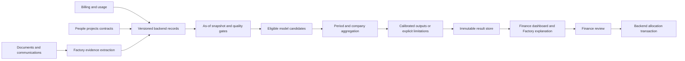

# Forecasting architecture decision

Research decision, October 24, 2026. **Proposed design**, informed by the independently researched tracks. No model has been trained on this enterprise population. This document chooses an architecture that can establish a winning configuration; it does not claim the literature establishes that configuration in advance.

## Recommended architecture

Build a modular forecasting service around an immutable, historically reconstructible financial dataset and a controlled model registry. Deliver forecasts for company and teams, with matched currency, categories, coverage and periods. Keep cost observation, future demand, commercial transformation, attribution, uncertainty and finance decisions as separate operations. Prefer a small Python numerical package with CLI and a thin service adapter initially; backend remains authoritative for ingestion, monetary arithmetic and saved finance decisions. A distributed feature store or orchestration platform is optional infrastructure, not a prerequisite.

**Established evidence:** data formats, provider reports and telemetry have different grain and financial meaning; point-in-time feature retrieval can require an additional availability-time constraint; forecast coherence does not by itself establish calibrated cumulative uncertainty. These findings and their primary evidence are detailed in [connectors](tracks/03-connectors.md), [reconciliation](tracks/09-reconciliation.md) and [operations](tracks/19-operations.md).

**Inference:** target and information-set errors can invalidate every model at once. Architectural correctness therefore needs independent acceptance gates before model performance is compared. The finance workflow can still use recorded spending and reviewed internal budgets when a forecast is unavailable.

**Unvalidated hypotheses:** pooled learning, structured context, session continuation, direct cumulative prediction or a foundation model may improve useful forecasting. Each is an experiment with an incumbent and rejection condition, not an unquestioned dependency.

## Alternative architectures and decision conditions

| Architecture | Why it can be suitable | Main cost or failure | Current disposition and overturning condition |
|---|---|---|---|
| Direct aggregate numerical forecasts | Predicts the finance target with relatively little identity dependence | Hides population/price changes and explains causes poorly | Required baseline and initial serving path; replace if richer approach materially improves matched-target outcomes |
| Individual/task bottom-up models | Can reflect staffing and heterogeneous workloads | Sparse people, missing attribution, correlated errors and unstable session identity | Challenger; choose only if aggregate improvement exceeds additional data and operating burden |
| Driver-based usage and contract model | Explicit workload/model/pricing scenarios; deterministic contract changes | Errors in multiple drivers and nonlinear shared allowances; task count and cost may covary | Use for reconciled usage-priced targets and scenarios; do not substitute for provider charges without reconciliation |
| Context-first LLM/agent forecaster | Flexible interpretation of plans and new conditions | Hindsight, persuasive but uncalibrated numbers, repeated experimentation and inference cost | Research arm; numerical promotion requires human-verified-context and strongest numeric comparisons |
| Pretrained or managed forecasting service | Potential strong zero-shot starting point and less training engineering | License/tenant restrictions, unknown domains, incomplete covariance/path support, service cost and availability | Optional adapter, gated by the actual checkpoint/service rather than family name |
| Adaptive ensemble or model-building agent | May adapt across companies and regimes | Selection overfit, hidden search cost, irreproducible per-company changes | Later registered procedure, evaluated as a complete policy on untouched outcomes |

These are compatible modules, not a mandate to deploy every one. Compare the smallest meaningful set at each stage and stop adding complexity when evidence does not justify it.

## Architectural decisions and falsification tests

| Decision | Adopt initially | Alternative to compare | What could reverse the choice |
|---|---|---|---|
| Financial target | Covered-source incurred variable charges; fixed obligations and late-incurred estimates separately | Token-only, contract-priced usage or invoice-period target | Coverage/history audit shows the monetary label is unreconstructible or inconsistent |
| Time representation | Raw UTC timestamps plus explicit source/reporting timezone and half-open intervals; daily materialization where supported | Weekly/local source-calendar models | Weekly models improve exact cumulative targets after partial-week handling, or source grain cannot support daily labels |
| Identity | Crossed effective-time and known-time relations with unattributed bucket | Static company/team mapping for a proven stable subset | Simpler subset passes transfer/shared-account tests without changing financial meaning |
| Model unit | Team and company baselines; compare pooled teams, individual-summary features and individuals | Person/project/task conditional models | Identifiable fine-grained history produces consistent aggregate gains and viable latency |
| Temporal prediction | Daily mean paths for composable arbitrary periods | Direct cumulative 7/14/30/month-remainder models | Direct target errors improve without unacceptable period/monotonicity incoherence |
| Context | Event ledger, explanations and conditional scenarios; no invented uplift | Learned event effects, embeddings, direct LLM and ensembles | Human-verified context adds predictive signal and extraction preserves it under as-of replay |
| Uncertainty | Return unsupported when not established; compare direct target calibration and joint paths | Parametric, block bootstrap, distributional ML and conformal variants | Held-out cumulative coverage, proper score, width and delay behavior establish a supported method |
| Refresh | On new valid snapshots or explicit request; configurable | Daily schedule, within-day session updates, drift triggers | Source latency and finance benefit justify measured extra cost; source refresh is not model refit |
| Deployment | Modular Python service/package with ordinary backend integration | Managed service or separate distributed systems | Scale, latency, compliance or team ownership actually warrants the added infrastructure |

No mandatory 28-day history or universal training window is established by this research. Include 7/28/56-day and expanding-window candidates only when their required complete observations exist, and tune on development origins. A documented fallback may use a 28-day weekday mean, but its window is a configuration choice rather than a property of enterprise usage.

## Components and shared contracts

### 1. Backend source and financial boundary

Backend provides immutable raw observations, revisions and extraction manifests; source and account inventory; source precedence/overlap rules; completeness and maturity; exact monetary quantities; effective and known-time ownership; versioned contracts and budget snapshots. Preserve tombstones/retractions and reset semantics. A successful HTTP response is not evidence that every account, field or page was covered.

The modeling layer may calculate floating-point numerical predictions, but authoritative amounts and transformations use exact decimal semantics with declared scale/rounding. Historical source precision must survive ingestion. Each target declares additive-by-date, nonnegative-support and contract-state capabilities. Shared pools, minimums and whole-volume repricing need full-period state; price complete joint demand with the incurred prefix before deriving remainder or attribution. Independent future-only tariffs can miss an allowance already consumed or reprice prior activity incorrectly. Pricing adapters must state supported tariffs and reject unknown categories rather than invent prices.

### 2. Snapshot builder and eligibility

Build one immutable manifest per origin. Every input must be valid for its service/event interval and available to the operational system by the cutoff. Archive document versions, feature/extractor timestamps and source permissions where needed. A historical effective date alone does not establish historical knowledge.

Quality rules return usable, limited or unusable scope with machine-readable reasons. Partition completeness is checked independently of numerical model eligibility. Exclude incomplete days only through a declared policy; do not silently collect the last N observed dates across outages and pretend they are consecutive days. Do not treat privacy-suppressed metrics as zero.

### 3. Model registry and numerical interface

Every candidate declares target types, grain, minimum history, supported covariates, local/global scope, forecast statistic, supported horizons, output distribution semantics, required dependencies/license and resource budget. The registry includes deterministic baselines, classical models, regularized/pooled models and a strong tabular challenger before optional larger models. See [method selection](methods-review.md).

Results identify a coherence bundle: target/statistic, component set, dates, mapping and path construction. Independently selected cumulative and daily models cannot be combined as though they share one coherent path. A common interface accepts an immutable snapshot, training cutoff, forecast request and configuration; returns a validated result or typed unavailability. Fit and predict are separate from selection and calibration. All fitted preprocessing uses only admissible history. Maintain label queues with target-end, first-available, mature, revision and score-as-of timestamps. Only delivered labels update fitting, calibration, ensemble weights or adaptive state; later truth may score old outputs but never rewrite their past state. Track all scheduled/requested opportunities, not just successful source refreshes. Known-future features must truly be available at origin; other future features are forecast drivers or scenario assumptions.

### 4. Context and scenarios

Factory supplies source-backed event revisions and explanations. Forecasting controls numerical eligibility and effect mappings. An approved plan is evidence of intention; execution, date and amount are separate unknowns. Shared initiative deduplication prevents repeated summaries becoming repeated spending increments.

A scenario has explicit changed assumptions, base result ID and versioned pricing/behavior transformation. A price-only scenario holds usage fixed by assumption; it does not predict rebound demand. Internal budget redistribution changes the comparison envelope, not predicted usage mechanically. Label evidence-backed scenarios separately from user-entered stress assumptions. Scenario spread is not a prediction interval.

### 5. Coherent totals and supported risk

Use a disjoint expense partition and a versioned date/entity incidence matrix. Team totals plus central/unattributed costs equal the covered company total on the same basis. Person, project and model are crossed views, so their totals must never all be added together. Provider adoption/team reports are not assumed to be such a partition.

For mean forecasts, first verify that each path value is an original-scale multistep conditional mean: iterating a nonlinear one-step mean model on its own predicted lags is generally only a plug-in point path. Obtain multistep means by direct horizon training or averaging valid stochastic recursive paths. Then sum exact target-date mean paths or reconcile a vector of cumulative forecasts under valid constraints. Keep direct company and unreconciled forecasts as evaluation challengers. For an additive nonnegative target, nested-period means should respect monotonicity; whole-volume repricing, signed adjustments and contract reallocations can invalidate that property. Do not infer monotonicity merely from a gross/nonnegative label; signed financial adjustments require different support. Record any projection/reconciliation correction and evaluate it, rather than quietly clipping values.

For risk, sum jointly sampled entity-by-date paths before computing quantiles, or calibrate the exact cumulative target directly. A cross-sectional covariance model at each horizon may still omit dependence across dates. Per-person, per-team and per-day quantiles generally cannot be added. A marginal quantile model is not a complete joint scenario generator. Interval, marginal-quantile, event-probability and joint-path capabilities have separate gates. An interval-only calibrator may emit supported bounds but leaves breach probability unavailable; arbitrary-threshold probability needs a qualified CDF or direct event estimator with reliability/proper-score evidence. Calibrate and evaluate the final priced/reconciled/composed target, including dependence between late-incurred and future components where applicable. No risk output is emitted until its specific gate passes.

### 6. Immutable results and consumer interfaces

Requests include target and scope IDs, observation cutoff, requested interval, full/remainder meaning, currency/basis, forecast or scenario, assumptions, requested statistic and model/config policy. Reject incompatible period/unit/category/target combinations. Preserve the difference between a forecast period and a financial report period.

Results include immutable ID; input and code/model/feature/context/mapping/pricing versions; created time and observation watermark; period/scope/unit; point statistic; observed-incurred, estimated late-incurred, future continuation and fixed obligations as separate components; supported interval/probability semantics and calibration support; quality/coverage/limitations; selected candidate/fallback and reason. Status includes available, limited and unavailable. Staleness is a read-time assessment over an immutable result, not rewriting the result originally reviewed.

Frontend and Factory display the returned meaning. Backend records decisions against the exact result and evidence versions reviewed. Separate business requester, assistant proposer and authorized finance approver. A source document or assistant cannot approve its own proposal; role rules determine whether the finance user who requests an analysis is authorized to approve the resulting change. Approval uses current budget version and decision-relevant evidence dependencies. A changed bill, withdrawn plan or inaccessible evidence can require renewed review even when the budget version is unchanged. Pending/failed/rejected transactions do not become confirmed allocations; retries use idempotency and compare-and-swap semantics owned by backend.

## Experiment sequence and release boundary

1. Establish source target/coverage/reconciliation and historical availability; deliver exact arithmetic and fault fixtures.
2. Compare strong transparent baselines and classical state/regression methods on exact periods, including unavailable requests and cost.
3. Compare global/local learning and granularity separately; then individual-derived features and grouped reconciliation.
4. Compare direct money, activity/severity and usage/pricing formulations; evaluate direct cumulative models against daily paths.
5. Test numeric, human-verified context, Factory-extracted context, embeddings, direct LLM and ensemble arms with equal information.
6. Test session continuation and adaptation after measuring telemetry/label latency; include true shared shocks and observation-regime failures.
7. Admit neural/foundation methods and adaptive selectors only where license, data volume, privacy and prospective evaluation justify them.
8. Freeze the complete development-selected procedure with separate calibration and untouched final periods; register search/compute budgets and report matched-information plus full-feature comparisons. Shadow it on future origins, and promote by capability-specific gates. Keep a replayable incumbent/fallback.

Implementation acceptance concerns correct software behavior and integration. Empirical acceptance concerns real target accuracy, uncertainty and usefulness. Synthetic traces can pass the former and cannot establish the latter. Real manager forecasts must be independently recorded before outcomes; no synthetic “manager” comparator may be presented as observed finance practice.

## Stopping and escalation rules

A known source outage, invalid target, impossible currency comparison or unresolved duplicate economic charge blocks the affected result. Uncertain but valid partial scope can be returned only with explicit coverage and no full-company label. Lack of history may block a specific model without blocking a simpler eligible one. Lack of calibrated distributions blocks probabilistic warnings without blocking a valid point forecast.

No system can guarantee all future regimes, unseen commercial terms or every compound failure. The edge register specifies known risks and tests, and observability must expose unfamiliar categories rather than make them look normal. Finance's allocation policy, statistical forecasting and causal savings analysis remain separate responsibilities. Autonomous swarm enforcement remains deferred.

## Shared workflow acceptance

Run the Northstar alternatives independently from the original $60k/$80k/$60k allocation. Redistribution yields $85k/$50k/$65k under $200k. Additional $50k funding with the supplied prioritization yields $95k/$80k/$75k under $250k. These are synthetic examples, not a mandated optimal policy. Verify rejection, stale evidence, repeated apply and saved receipt behavior. Factory's real SDK must retrieve evidence and call the supported forecast/scenario interface inside the product; code-generation use or a mocked runtime cannot satisfy that integration requirement. Source scope: [original master snapshot](requirements-snapshots/ai-spend-master-plan.md).

Separate team/personal portals, employee budgets, outbound notifications, autonomous swarm budgeting, recursive delegation and runtime enforcement remain deferred. This does not exclude observing human-initiated subagents as part of current usage.

Team forecast promotion does not promote donor/recipient selection. Register and evaluate the actual frozen selection rule on its chosen population and all decision opportunities, including pending outcomes. Match forecast coverage/categories with the entire budget envelope; uncovered obligations or unknown late-incurred charges block a claim of supported transferable headroom. See [evaluation protocol](evaluation-protocol.md) for selection-specific shortfall exposure and capability gates.
