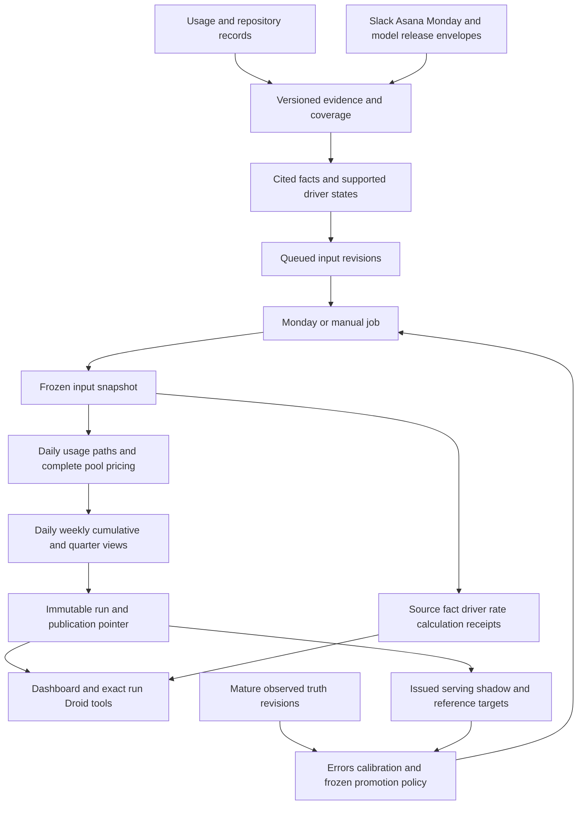

# Forecast integration architecture

The product backend calls `forecasting.planning` and `forecasting.learning` directly. SQLite holds append-only input revisions, frozen input snapshots, durable jobs, immutable runs, and a separately fenced publication pointer. Read APIs never issue a forecast or rebase a stored curve.

## Inputs and temporal boundaries

A `ForecastInputSnapshot` identifies tenant, target, unit, financial basis, period, UTC timezone, source revisions, coverage/maturity, people, effective memberships, projects, configurations, pricing, and active drivers. Canonical components preserve person-or-shared, project-or-shared, configuration, meter, and billing pool.

`information_cutoff`, `history_complete_through`, `forecast_start`, `generated_at`, and actual publication time have distinct meanings. A source must be both available and received by an historical cutoff. Corrections append versions. A required source/day is unknown unless a completion record establishes its value, including explicit zero. Repository charge imports alone do not attest complete daily usage, exposure, or person identity.

Monday jobs freeze Monday 00:00 UTC as origin and cutoff. Missed schedules recover using only reconstructible information, with their actual issuance time preserved. Manual jobs use current information and begin at the next UTC midnight, or the current midnight when requested exactly at that boundary. Today's unobserved remainder is excluded. The first manual week may be partial and carries explicit covered dates.

## Supported driver mappings

| Evidence | Numerical operation | Boundary |
| --- | --- | --- |
| Project schedule | Move identified future workload, preserving total work | Additional duration or work needs independent support |
| Joining, leaving, reassignment | Change effective exposure and membership | Ambiguous identities stay context-only |
| Workload quantity | Apply compatible observed usage per work/exposure unit | Unknown exposure cannot justify decomposition |
| Adoption | Change configuration mix for affected workloads from the effective date | A release or benchmark alone is not adoption or token savings |
| Pricing | Apply supported effective commercial terms to the full pool | Unsupported contract terms leave the affected total incomplete |

The fixture interpreter parses supported connector fields and bounded source prose automatically. It records source passages and native field paths. Unsupported or conflicting claims retain a reason. Absolute driver states, deduplication, and supersession prevent repeatedly multiplying the prior forecast.

The rate model uses exposure-weighted weekday means across the trailing 56 complete days, then compatible overall observed rates, then an explicitly authorized compatible cohort. A low/high configuration uses source bounds or deterministic 200-replicate week-block bootstrap parameter choices. Branches use common draws; their priced mean envelope is descriptive, not future coverage. Missing parameter bounds remain qualified or unavailable.

## Results and explanations

Each `ForecastView` carries run/snapshot/procedure IDs, scope, cutoff, dates, recorded/late/future/fixed components, seven daily points, four Monday–Sunday planning buckets, cumulative points, and a conditional quarter continuation. Aggregation occurs within common paths before summaries. Company reconciliation explicitly names each team and person partition's shared residuals.

Historical-error intervals calibrate daily, weekly, and cumulative targets separately. Matching includes lead, duration, scope, unit, basis, timezone, procedure artifact, and delay policy. Nonoverlapping mature targets are selected deterministically. The finite rank can be unavailable; marginal widths are never summed. Pointwise intervals do not cover an entire path jointly.

The source chain is persisted as `source revision → fact → driver → rate/mapping → snapshot → calculation → result`. A factor's displayed effect is a paired rerun omitting that factor while holding other inputs and draws fixed. Interacting effects need not add to the total change. Included, queued, and context-only states remain distinct. Current actuals carry their own revisions beside the immutable issued result.

## Product interfaces

| Route | Meaning |
| --- | --- |
| `GET /api/forecast-views` | Published or immutable run views, optional `scope_type`, `scope_id`, `run_id`; separate current actuals |
| `POST /api/forecast-refreshes` | Idempotent manual job with required `Idempotency-Key` |
| `GET /api/forecast-refreshes/{id}` | Durable status, attempts, or failure; no lease capabilities exposed |
| `GET /api/forecast-runs/{id}/explanation` | Stored evidence and calculations, optional scope/driver |
| `POST /api/forecast-runs/{id}/scenarios` | Isolated scenario; `drivers` replaces the complete global driver set |
| `GET /api/forecast-scenarios/{id}` | Stored completed scenario; pending jobs use the refresh-status route |
| `GET/POST /api/forecast-evidence` | Evidence states and connector envelope ingestion |

The same forecast routes mount beneath `/compat` for the frontend HTTP client. Legacy quarter consumers adapt only an actual matching quarter outlook, preserving unavailable totals. Droid tools are `explain_forecast`, `compare_forecasts`, `preview_forecast_scenario`, and `request_forecast_refresh`. Structured requests pin exact run, scope, and driver IDs; they do not infer a run from the latest chart.

Workers use persisted leases, heartbeats, retries, and fencing. Completion atomically archives issued predictions and conditionally updates the publication pointer. An older cutoff cannot displace a newer publication. A scenario never updates that pointer. Material evidence invalidates dependent finance proposals in the ingestion transaction; drafting and approval recheck under a write lock. Derived error bookkeeping is excluded from material fingerprints.

Procedure fingerprints cover the core numerical implementation plus explicit versioned hashes of
the evidence extractor and repository adapter. Changed interpretation or feature mappings cannot
reuse an older procedure's errors or frozen promotion experiment. The current deterministic
extractor uses no model prompt; answer-only Droid prompts do not affect the numerical procedure.

See [learning](../learning/README.md) for truth revisions, error receipts, artifact fingerprints, prospective issuance deadlines, and model replacement rules.
